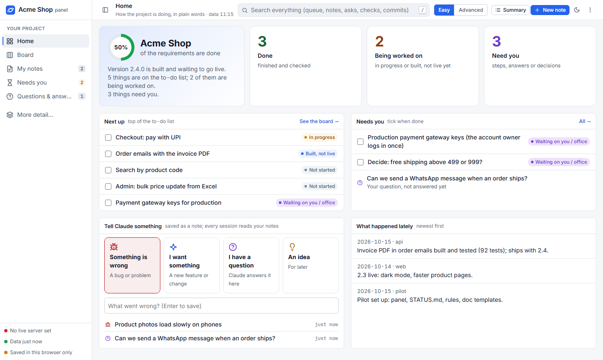
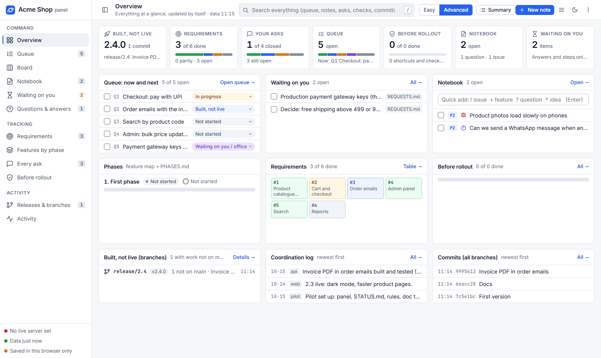
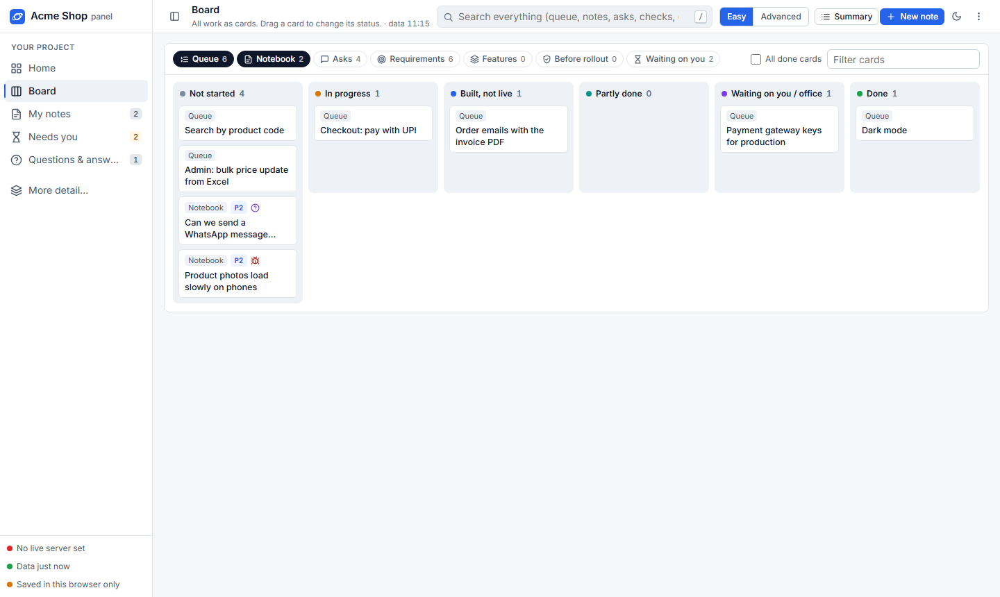
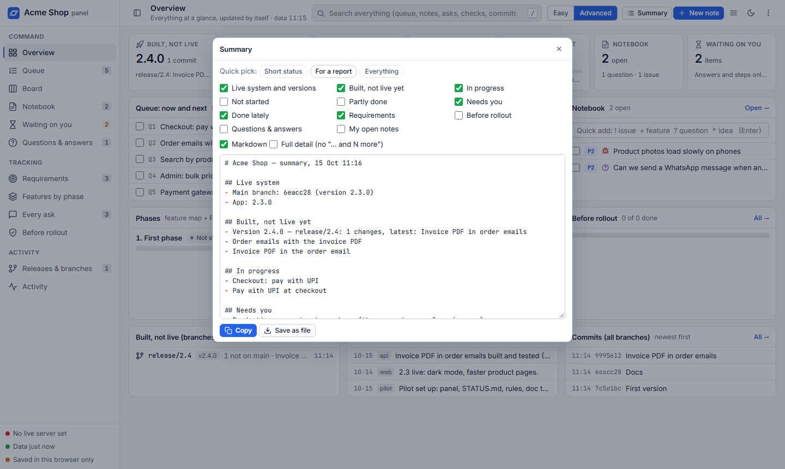

# Pilot

**Run a software project with several Claude Code sessions at once, without chaos and without burning tokens.**

Pilot gives any git project:
- a **self-updating project panel** that opens from your Desktop
- a **short status file** that every new Claude session reads first, instead of re-reading old chats and big docs
- a set of **working rules and docs** that let sessions and helper agents coordinate: who is deploying, who edits which files, what the user asked, what's next

One command sets it all up.



## Why
Long AI-assisted projects run into the same problems:
- Every new session spends thousands of tokens catching up.
- Two sessions deploy at the same time.
- Requests get lost between chats.
- Nobody knows what's built but not live.
- The owner can't see the state of the project without asking.

Pilot fixes these with plain files in your repo, a few background tasks, and one HTML page.

## Features
**The panel**
- **Easy mode** (the default): the project in plain words.
  - A progress ring, plus *Done / Being worked on / Need you* counts
  - What's next, and what's waiting on you
  - Big *Something is wrong / I want something / I have a question / An idea* buttons
  - The latest news
- **Advanced mode:**
  - an overview with every number
  - the work queue (drag to reorder)
  - a kanban board (drag to change status)
  - a notebook with types, priorities, tags and sorting
  - requirements, features per phase, every request, a before-rollout checklist
  - releases and branches (what's built but not on main)
  - an activity log and recent commits
  - search across everything
- **Summary button:** pick what you want (built not live, in progress, not started, partly done, needs you, done lately, requirements, questions and answers, your notes). Get plain text or Markdown to copy or save, with presets for a quick status or a report.
- **Questions & answers:** every question asked in chat and its answer, searchable, so nothing gets asked twice.
- **Your edits stay:** ticks, statuses, queue order and notes save automatically through a small local helper. Claude sessions read them, and can write answers back.
- **It updates itself:** a background task refreshes the data every 2 minutes, and the open page reloads it in place every 30 seconds.
- Light and dark themes, works at phone width, keyboard shortcuts, no internet needed.

| Advanced mode | Kanban board | Summary |
|---|---|---|
|  |  |  |

**For Claude sessions**
- **STATUS.md** (about 5–10 KB, every 2 minutes), built from the docs, git, an optional health URL and your panel edits. It holds:
  - the live version and the live lock
  - branches that aren't on main yet
  - the queue in your order, with your ticks
  - your open notes and what waits on you
  - the latest questions and answers, log lines and commits
- **A SessionStart hook** puts STATUS.md into every new session automatically.
- **The rules block in CLAUDE.md:**
  - status first, then only the doc section you need
  - graphify for code questions
  - queue, don't jump
  - one live action at a time
  - file claims, log lines
  - every ask recorded, every question recorded
  - helper model choice and step budgets
  - clean handoffs
  - test shortcuts listed before the rollout
- **Doc commands** (`pilot.ps1 lock / unlock / log / ask / qa / archive`): sessions update the docs without opening big files.
- **Claude commands:** `/status`, `/resume`, `/handoff`, `/qa`, `/summary`.
- **[graphify](https://pypi.org/project/graphifyy/)** code map: set up with its git hook. The panel shows how fresh it is and refreshes it when it falls behind.
- **Doc size guard:** the panel warns when a doc grows past a limit, and `pilot.ps1 archive` moves old log rows out.

## Quick start
```powershell
git clone https://github.com/white-venom/pilot "$HOME\pilot"
powershell -ExecutionPolicy Bypass -File "$HOME\pilot\pilot.ps1" install -Project C:\path\to\your\project -Name "My Project"
```
Then open **`My Project panel.html`** on your Desktop, and commit the new `docs/project/`, `CLAUDE.md` and `.claude/commands/`.
Start Claude Code in the project as usual: the first message already has the status.

Install options:
| Option | What it does |
|---|---|
| `-HealthUrl https://host/api/health` (+ `-HealthInsecure` for a self-signed certificate) | shows whether the live server is up and its version |
| `-VersionFile 'App=package.json="version":\s*"([^"]+)"'` | shows a version from a file (label=path=regex; without a regex the whole file) |
| `-Areas Frontend,Backend,Infra` | the areas offered for notes |
| `-Language English` | the language the rules ask Claude to reply in |
| `-NoTasks` | no background tasks (build by hand with `pilot.ps1 build`) |

Running `install` again is safe: it repairs, and keeps your docs and data.

**Requirements:**
- Windows 10/11 or Windows Server with Windows PowerShell 5.1, and git.
- Node.js runs the local save helper. Without it, your panel edits stay in the browser only.
- graphify is optional: `pip install graphifyy`.
- Chrome or Edge for the panel.
- No admin rights needed.

## Every day
| You want | Do |
|---|---|
| See how it's going | Open the panel |
| Tell Claude about a bug, a wish or a question | Home → *Tell Claude something* |
| A report for someone | **Summary** → pick the parts → Copy |
| Change the order of work | Advanced → Queue, or drag cards on the Board |
| Start a session | Just start it. `/resume` takes the next item |
| Pause | `/handoff` (writes RESUME.md, releases the lock, commits) |
| Something looks stale | `pilot.ps1 doctor -Fix` |

## Commands
```
pilot.ps1 install   -Project <path> [-Name ..] [-HealthUrl ..] [-VersionFile ..] [-Areas ..] [-Language ..] [-NoTasks]
pilot.ps1 doctor    [-Fix]                      tasks, helper, data age, code map, hook, doc sizes
pilot.ps1 status | context | build              STATUS.md / what the hook prints / refresh now
pilot.ps1 lock   -Who <s> -What "<what>"        take the live lock (refused when someone else holds it)
pilot.ps1 unlock -Who <s>                       release it
pilot.ps1 log    -Who <s> -Text "<done>"        one line in the coordination log
pilot.ps1 ask    -Text "<request>" [-Queue]     record a request (and put it at the end of the queue)
pilot.ps1 qa     -Q "<question>" -A "<answer>"  record a question from chat and its answer
pilot.ps1 archive [-Days 14]                    move old log rows to docs/project/archive/
pilot.ps1 uninstall                             remove the background tasks (docs and data stay)
```
`-Project` defaults to the git project of the current folder.

## How it works
```
your project/                       Documents\Pilot\<project>\        (private, per machine)
  CLAUDE.md  (rules block)            pilot.json   settings
  docs/project/*.md  (the docs) ──►   live-data.js ◄── read by the panel every 30 s
  .claude/commands/                   STATUS.md    ──► also graphify-out/STATUS.md ──► SessionStart hook
  graphify-out/  (code map)           panel.json   ◄── your ticks, notes, order (via the local helper)
                                      token.txt    the helper's secret
```
- **Task "Pilot panel - <name>":** runs every 2 minutes and at sign-in, as you, at normal priority. It reads the docs and git with read-only commands and writes the files above.
  - For each doc it takes the copy whose content changed last: the main folder, or any git worktree with work that isn't on main yet.
- **Task "Pilot panel - <name> (helper)":** a tiny Node server on `127.0.0.1` only, that accepts requests carrying its secret. The panel saves your edits through it.
- **Merging:** your edits merge item by item, and the newest wins. So a Claude session can answer one of your questions in `panel.json` while you're editing something else.
- **Status marks the panel reads in the docs:** ✅ done · 🟢 built, not live · 🔨 being built · ⏳ waiting on the user · ⚪ not started.

## Layout
```
pilot.ps1                   install, doctor and the doc commands
panel/board.template.html   the panel (a single file; fonts and data are embedded at build)
panel/build.ps1             reads the project; writes live-data.js and STATUS.md; builds the HTML
panel/status.ps1            writes STATUS.md
panel/panel-server.js       the local save helper (Node, no packages)
panel/fonts/                Inter and JetBrains Mono (SIL Open Font License 1.1)
templates/docs/             COORDINATION, REQUESTS, QA, PROGRESS, PHASES, DECISIONS, BEFORE-ROLLOUT, RESUME, REPO-MAP, AUDIT
templates/CLAUDE.block.md   the rules block put into CLAUDE.md
templates/commands/         /status /resume /handoff /qa /summary
```

## License
MIT, see [LICENSE](LICENSE). The bundled fonts are under the SIL Open Font License 1.1.
